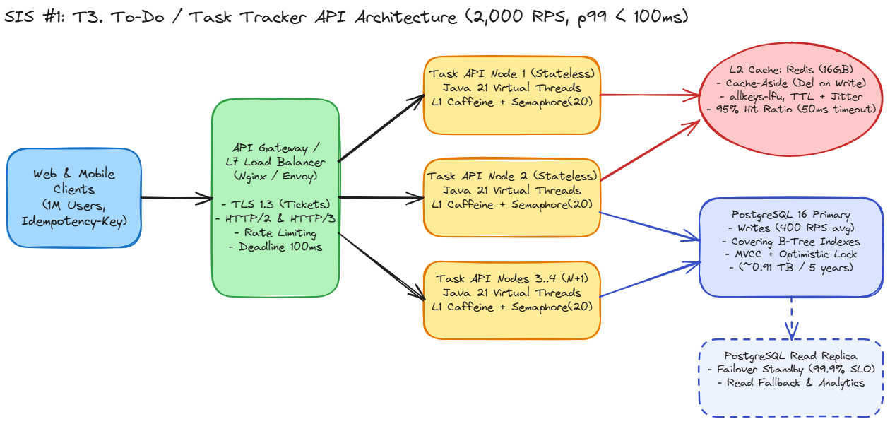

# SIS #1 — System Design: T3. To-Do / Task Tracker API

> 🌐 **Language:** [English](./README_EN.md) | [Русский](./README.md)

**Author:** Kalmakhanbet Nurasyl Dinmukhammeduly (ID: 23B030297, Group P2)  
**Course:** Backend for Highloaded Environment (Fall 2026)  
**Topic:** T3. To-Do / Task Tracker API  

---

## 1. System Requirements

### 1.1. Functional Requirements (FR)
1. **Task CRUD Operations:** Create a task (`title`, `description`, `priority`, `deadline`), read task details by ID, full and partial updates, and soft deletion (moving to `ARCHIVED` status).
2. **Lifecycle & Status Management:** Transition tasks across states: `TODO` → `IN_PROGRESS` → `DONE` / `ARCHIVED`.
3. **Filtering & List Retrieval:** Retrieve a user's task list filtered by `status`, `priority`, and `deadline` range, sorted chronologically using cursor-based (keyset) pagination.

### 1.2. Non-Functional Requirements (NFR & SLO)
* **User Scale:** `1,000,000` registered users (~`200,000` DAU).
* **Traffic Profile:** `2,000 RPS` average (`80%` reads / `20%` writes, Read:Write ratio = `4:1`).
* **Latency SLO:** `p50 < 20 ms`, `p99 < 100 ms`.
* **Availability SLO:** `99.9%` (error budget allows up to `43.8 minutes` of downtime per month / `8.8 hours` per year).
* **Consistency:** Strong *read-your-own-writes* consistency for the task owner achieved via cache invalidation on write (`delete on write`).

---

## 2. Back-of-the-Envelope Estimation

Calculations follow the 5-step estimation recipe from Lecture 1:

### Step 1. Traffic (Reads & Writes)
* **Average RPS:** `2,000 RPS`
  * **Reads (80%):** $2,000 \times 0.8 = 1,600\text{ RPS}$ (fetching task lists, filtering by status and deadline).
  * **Writes (20%):** $2,000 \times 0.2 = 400\text{ RPS}$ (creating tasks, updating statuses, editing fields).

### Step 2. Peak Traffic & Network Bandwidth
Using a standard daily **Peak Factor = 3x** (morning work-planning hours):
* **Peak Total RPS:** $2,000 \times 3 = 6,000\text{ RPS}$
* **Peak Read RPS:** $1,600 \times 3 = 4,800\text{ RPS}$
* **Peak Write RPS:** $400 \times 3 = 1,200\text{ RPS}$
* **Network Bandwidth:**
  * Reads (response containing 10–15 tasks $\approx 4\text{ KB}$):
    * Average: $1,600 \times 4\text{ KB} \approx 6.4\text{ MB/s}$
    * Peak: $4,800 \times 4\text{ KB} \approx 19.2\text{ MB/s}$
  * Writes (request payload $\approx 500\text{ B}$):
    * Average: $400 \times 500\text{ B} \approx 0.2\text{ MB/s}$ ($0.6\text{ MB/s}$ at peak).

### Step 3. Storage & Data Volume
* **Single `task` record size (including PostgreSQL MVCC tuple headers and B-Tree index overhead):**
  * `id` (8B) + `user_id` (8B) + `title` (~100B) + `description` (~250B) + `status` (2B) + `priority` (2B) + `deadline`, `created_at`, `updated_at` (24B) + `version` (4B) + heap tuple header (`xmin`, `xmax`, `ctid` ~24B) + B-Tree index entries (~80B) $\approx \mathbf{500\text{ Bytes}}$.
* **Data Growth:**
  * Assuming `200,000` Daily Active Users (DAU) create an average of `5` new tasks per day:
    $$\text{New tasks per day} = 200,000 \times 5 = 1,000,000\text{ tasks/day}$$
  * Daily growth: $1,000,000 \times 500\text{ B} = \mathbf{0.5\text{ GB/day}}$.
  * Yearly growth: $0.5\text{ GB} \times 365 = \mathbf{182.5\text{ GB/year}}$.
  * 5-Year Retention total: $182.5\text{ GB} \times 5 \approx \mathbf{0.91\text{ TB}}$.
* **Storage Verdict:** $< 1\text{ TB}$ over 5 years comfortably fits on a **single PostgreSQL primary node** (paired with a Read Replica for high availability). Horizontal database sharding is unnecessary and avoided to prevent cross-shard complexity.

### Step 4. Working Set (Hot Data for Cache)
* Read traffic predominantly targets active tasks (`TODO` and `IN_PROGRESS`).
* Assuming an average of `20` active tasks across `1,000,000` users:
  $$\text{Working Set} = 1,000,000 \times 20 \times 500\text{ B} = \mathbf{10\text{ GB}}$$
* The entire hot working set fits in a single **Redis instance (16 GB RAM)**.
* With a target **Cache Hit Ratio = 95%**:
  * Effective read latency ($t_{cache} = 0.5\text{ ms}$, $t_{db} = 5\text{ ms}$):
    $$T_{eff} = 0.95 \times 0.5 + 0.05 \times 5.0 = \mathbf{0.725\text{ ms}}$$
  * Database read load drops by 20x:
    * Average DB Reads: $1,600 \times 0.05 = \mathbf{80\text{ RPS}}$
    * Peak DB Reads: $4,800 \times 0.05 = \mathbf{240\text{ RPS}}$

### Step 5. Capacity & Connection Pool Sizing via Little's Law ($L = \lambda \times W$)
1. **Application Tier (Stateless Task API):**
   * At peak $\lambda = 6,000\text{ RPS}$ and average in-system time $W = 20\text{ ms} = 0.02\text{ s}$:
     $$L_{api} = 6,000 \times 0.02 = \mathbf{120\text{ concurrent requests in flight}}$$
   * Built on **Java 21 with Virtual Threads** (M:N lightweight scheduling avoids blocking OS threads during I/O waits).
   * To handle `6,000 RPS` at peak and satisfy the `99.9%` availability SLO ($N+1$ redundancy), we deploy **3 active instances + 1 spare instance = 4 stateless API nodes** (4 vCPU, 8 GB RAM each) behind an L7 Load Balancer.
2. **PostgreSQL Connection Pool (HikariCP):**
   * Peak traffic reaching PostgreSQL is $\lambda_{db} = 240\text{ (read misses)} + 1,200\text{ (writes)} = 1,440\text{ RPS}$.
   * With indexed query execution time $W_{db} = 5\text{ ms} = 0.005\text{ s}$:
     $$L_{db} = 1,440 \times 0.005 = \mathbf{7.2\text{ active connections}}$$
   * Accounting for tail variance and lock waits, each of the 4 API instances is configured with a **pool size of 20 connections** (80 total connections across the fleet), guarded by an explicit `Semaphore(20)` per instance.

---

## 3. High-Level Architecture

*(Editable source diagram included in the repository: `architecture.excalidraw`)*

### Core Architectural Decisions:
1. **Transport & Security:**
   * Public edge (API Gateway / Nginx) terminates **TLS 1.3** (1-RTT handshake, shared Session Ticket keys across balancer nodes, ALPN advertising `h2`) and serves **HTTP/2 and HTTP/3 (QUIC)**.
   * Upstream connections from the gateway to API instances use warm connection pools (`Keep-Alive`, `TCP_NODELAY`), eliminating cold TCP/TLS handshake penalties per request.
2. **Stateless vs. Stateful Separation:**
   * `Task Service` nodes are strictly **Stateless** — any instance can serve any request, enabling fast horizontal scaling and zero-downtime rolling deploys.
   * State is pushed down to **Redis** (distributed L2 cache) and **PostgreSQL 16** (Primary for writes + Read Replica for failover and read fallback).

---

## 4. API Contract

In accordance with the boundary rule from Lecture 3, **REST over HTTP/2 (JSON)** is chosen for the public boundary because external web and mobile clients are outside our build control. Large list responses use `zstd` / `gzip` compression.

### Endpoints (Path Versioning: `/api/v1`)

| Method | Path | Purpose | Idempotency | Status Codes |
| :--- | :--- | :--- | :--- | :--- |
| `POST` | `/api/v1/tasks` | Create a new task | Requires `Idempotency-Key: <UUID>` header | `201 Created`, `400`, `429`, `503` |
| `GET` | `/api/v1/tasks` | List tasks (filtered, cursor-paginated) | Yes (`SAFE`, `IDEMPOTENT`) | `200 OK` |
| `GET` | `/api/v1/tasks/{id}` | Get single task by ID | Yes (`SAFE`, `IDEMPOTENT`) | `200 OK`, `404 Not Found` |
| `PUT` | `/api/v1/tasks/{id}` | Full task replacement (checks `version`) | Yes (`IDEMPOTENT`) | `200 OK`, `409 Conflict` |
| `PATCH` | `/api/v1/tasks/{id}/status` | Update status (`{"status": "DONE", "version": 2}`) | Yes (setting an explicit state is idempotent) | `200 OK`, `409 Conflict` |
| `DELETE` | `/api/v1/tasks/{id}` | Archive / soft-delete task | Yes (`IDEMPOTENT`) | `204 No Content`, `404` |

### Idempotent Task Creation Example (`POST /api/v1/tasks`)

**Request:**
~~~http
POST /api/v1/tasks HTTP/2
Host: api.tasktracker.kz
Authorization: Bearer <JWT>
Idempotency-Key: 8f14e45f-ceea-467a-a8f8-159b32c5f7b1
X-Request-Deadline-Ms: 90
Content-Type: application/json

{
  "title": "Submit SIS #1 for Highload",
  "description": "Prepare capacity calculations, DB schema, and report",
  "priority": 1,
  "deadline": "2026-10-20T18:00:00Z"
}
~~~

**Response (`201 Created`):**
~~~json
{
  "id": 904218,
  "user_id": 4217,
  "title": "Submit SIS #1 for Highload",
  "status": "TODO",
  "priority": 1,
  "deadline": "2026-10-20T18:00:00Z",
  "version": 1,
  "created_at": "2026-10-14T09:30:00Z"
}
~~~

---

## 5. Data Model, Indexes & Transactions (PostgreSQL 16)

### 5.1. DDL Schema
~~~sql
CREATE TABLE users (
    id BIGSERIAL PRIMARY KEY,
    email VARCHAR(255) NOT NULL UNIQUE,
    created_at TIMESTAMPTZ NOT NULL DEFAULT now()
);

CREATE TABLE tasks (
    id BIGSERIAL PRIMARY KEY,
    user_id BIGINT NOT NULL REFERENCES users(id),
    title VARCHAR(255) NOT NULL,
    description TEXT,
    status SMALLINT NOT NULL DEFAULT 1,   -- 1: TODO, 2: IN_PROGRESS, 3: DONE, 4: ARCHIVED
    priority SMALLINT NOT NULL DEFAULT 2, -- 1: HIGH, 2: MEDIUM, 3: LOW
    deadline TIMESTAMPTZ,
    version INT NOT NULL DEFAULT 1,       -- Optimistic locking version
    created_at TIMESTAMPTZ NOT NULL DEFAULT now(),
    updated_at TIMESTAMPTZ NOT NULL DEFAULT now()
);

CREATE TABLE idempotency_keys (
    key UUID PRIMARY KEY,
    user_id BIGINT NOT NULL,
    response_code INT NOT NULL,
    response_body JSONB NOT NULL,
    created_at TIMESTAMPTZ NOT NULL DEFAULT now()
);
~~~

### 5.2. Indexing Strategy & Query Planner Justification
The hottest query in the system fetches a user's tasks by status, ordered by deadline, using keyset (cursor) pagination instead of `OFFSET`:

~~~sql
SELECT id, title, status, priority, deadline, version
FROM tasks
WHERE user_id = $1
  AND status = $2
  AND (deadline, id) > ($3, $4)
ORDER BY deadline ASC, id ASC
LIMIT 20;
~~~

**Index Design (Leftmost Prefix Rule: equality columns first, then range/sort columns):**
~~~sql
-- 1. Composite Covering Index enabling Index Only Scan (no heap visits)
CREATE INDEX idx_tasks_user_status_deadline
ON tasks (user_id, status, deadline ASC, id ASC)
INCLUDE (title, priority, version);

-- 2. Partial Index for active tasks dashboard (smaller footprint, lower write amplification)
CREATE INDEX idx_tasks_active_deadline
ON tasks (user_id, deadline ASC)
WHERE status IN (1, 2); -- Only TODO and IN_PROGRESS
~~~

* **Why this executes in `< 1 ms`:** A 4-level B-Tree narrows down `(user_id, status)` via equality, walks sorted leaf pages for `(deadline, id)`, and serves `title`, `priority`, and `version` directly from the `INCLUDE` payload via an **Index Only Scan** with zero random heap fetches.

### 5.3. Concurrency Anomalies (Lost Update) & MVCC Tuning
* **Preventing Lost Updates:** Under PostgreSQL's default `Read Committed` isolation level, concurrent edits from two devices can silently overwrite each other. We enforce **Optimistic Locking** via the `version` column:
  ~~~sql
  UPDATE tasks
  SET status = $1, version = version + 1, updated_at = now()
  WHERE id = $2 AND user_id = $3 AND version = $4;
  ~~~
  If `0 rows` are updated, the service returns `409 Conflict`.
* **Idempotent `POST` Execution:** Task insertion and `idempotency_keys` recording execute inside a single `@Transactional` boundary. A `UNIQUE` constraint on `key` resolves concurrent retry races atomically. Keys expire after 24 hours.
* **MVCC & Lock Guardrails:**
  * `statement_timeout = '2s'`
  * `lock_timeout = '500ms'`
  * `idle_in_transaction_session_timeout = '10s'` (prevents abandoned transactions from holding old snapshots and blocking `autovacuum`).

---

## 6. Caching Strategy

We implement a two-tier cache hierarchy using the **Cache-Aside + Delete on Write** pattern:

1. **L1 Cache (In-process Caffeine):**
   * Bounded to `10,000` keys with a short `TTL = 3 s`.
   * Absorbs hot-key bursts and coalesces concurrent misses within a node via `LoadingCache`.
2. **L2 Cache (Shared Redis):**
   * **Key Design:**
     * `task:{id}` — single task payload (`TTL = 10 min`).
     * `user:{user_id}:tasks:status:{status}:page1` — first page of a user's task list (`TTL = 5 min`).
   * **Write Invalidation:** Every `POST / PUT / PATCH / DELETE` commits to PostgreSQL first and then issues `DEL` on affected Redis keys (plus publishes an invalidation event to evict L1 across instances). Deleting instead of setting avoids the *stale-write race* between concurrent writers.
   * **Redis Configuration:** `maxmemory 16gb`, `maxmemory-policy allkeys-lfu`, client socket timeout `50 ms`.

### Defences Against Cache Failure Modes:
* **Cache Stampede (Dogpiling):** On an L2 miss, the caller acquires a short distributed lease (`SET lock:tasks:user:{id} NX PX 1000`). Only one worker queries PostgreSQL and populates Redis; others wait briefly or read stale data.
* **Cache Avalanche:** All TTLs include random jitter `ttl = base_ttl * (0.9 + 0.2 * random())` so batch-populated keys never expire in the same second.
* **Cache Penetration:** Lookups for non-existent task IDs cache a `"NULL"` sentinel marker with a short `TTL = 45 s`.

---

## 7. Failure Modes & Resilience

| Failure Scenario | Impact Without Protection | Architectural Mitigation |
| :--- | :--- | :--- |
| **1. Network Drop on Write (Unknown Outcome)** | Client retries `POST` blindly and creates duplicate tasks. | Client sends a UUID `Idempotency-Key` and retries with **Exponential Backoff + Full Jitter** (max 3 attempts). Server atomically returns the stored `201 Created` response. |
| **2. Redis Outage or Slowdown** | App threads block on Redis sockets; connection pools saturate. | Strict `50 ms` Redis client timeout + **Circuit Breaker**. Reads fall through to PostgreSQL (Primary + Read Replica). B-Tree covering indexes allow PG to absorb all `1,600 RPS` (~35% node capacity). |
| **3. Database Slowdown / Traffic Spike** | Unbounded queues grow until OOM; client retries trigger a **Retry Storm**. | **Bounded queues**, downstream `Semaphore(20)` with a `30 ms` acquire timeout, and immediate **Load Shedding** (`503 Service Unavailable` with `Retry-After`). Retries are restricted to the client layer only with a 10% retry budget. |
| **4. Expired Request Budget** | Server wastes CPU and DB locks executing work after the caller timed out. | Propagated **Deadline Budget (`100 ms`)**: remaining time is checked before every cache or DB call; expired requests abort immediately. |
| **5. Single API Instance Crash** | In-flight requests on the node fail; sticky sessions would be lost. | API tier is **100% Stateless**. Load balancer health checks evict the dead node within 2 seconds; remaining 3 nodes absorb peak traffic seamlessly. |

---

## 8. AI Disclosure

In accordance with the course academic policy (Generative AI — Level D): Gemini AI was used to verify back-of-the-envelope capacity arithmetic (Little's Law and storage estimates), validate the PostgreSQL composite covering index structure, and format Markdown tables in both Russian and English reports. All architectural decisions, protocol choices, and failure mode trade-offs were reviewed and are understood by the author for the oral defense.