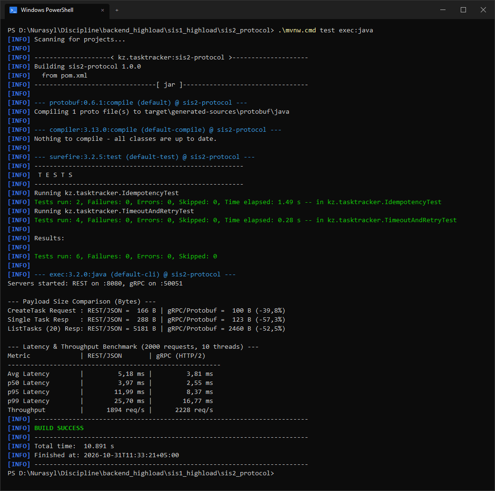

# SIS #2 — Protocol Implementation (gRPC vs REST/JSON)

**Автор:** Калмаханбет Нұрасыл Дінмұхаммедұлы (ID: 23B030297, Группа П2)  
**Дисциплина:** Backend for Highloaded Environment  
**Тема:** T3. To-Do / Task Tracker API — Protocol Implementation & Benchmark

---

## 1. Описание реализации

В первой части (SIS #1) для внешнего контура системы использовался REST/JSON. В рамках SIS #2 реализован сервисный интерфейс на Java 21 с использованием **gRPC (Protobuf over HTTP/2)** и проведено сравнение задержек (latency) и размера передаваемых данных (payload size) относительно базовой реализации **REST/JSON**.

### Сервисный контракт (`task_service.proto`)
Определены три основных метода сервиса `TaskGrpcService`:
* `CreateTask(CreateTaskRequest) -> CreateTaskResponse` — создание новой задачи с проверкой ключа идемпотентности.
* `GetTask(GetTaskRequest) -> GetTaskResponse` — получение задачи по `id`.
* `ListTasks(ListTasksRequest) -> ListTasksResponse` — получение списка задач пользователя с лимитом.

### Идемпотентность, таймауты и ретраи
1. **Идемпотентность (`Idempotency-Key`):**
   * При вызове `CreateTask` клиент передает UUID ключа идемпотентности (в поле запроса для gRPC или в заголовке `Idempotency-Key` для REST).
   * На стороне сервера (`TaskServiceCore`) используется потокобезопасное хранилище `ConcurrentHashMap<String, TaskDto>` с атомарной вставкой `putIfAbsent`.
   * При повторном запросе с тем же ключом новая запись не создается — сервер возвращает сохраненный объект и выставляет флаг `is_duplicate = true`.
2. **Таймауты (Deadlines):**
   * В gRPC клиенте перед каждым вызовом задается дедлайн через `stub.withDeadlineAfter(timeoutMs, TimeUnit.MILLISECONDS)`. На сервере проверяется `Context.current().isCancelled()`.
   * В REST клиенте используется `HttpRequest.Builder.timeout(Duration.ofMillis(timeoutMs))`.
3. **Повторные попытки (Retries с Exponential Backoff + Jitter):**
   * Ретраи выполняются только при временных сетевых сбоях (`Status.UNAVAILABLE`, `Status.DEADLINE_EXCEEDED` в gRPC и `503 Service Unavailable` / `IOException` в REST) при наличии ключа идемпотентности.
   * Задержка между попытками (до 3 ретраев) рассчитывается с экспоненциальным ростом и случайным разбросом (jitter), чтобы избежать синхронных повторных штормов:
     `sleepMs = random(base * 2^(attempt-1) / 2, base * 2^(attempt-1))`

---

## 2. Результаты замеров (gRPC vs REST/JSON)

Тестирование проводилось локально на одном хосте (Java 21.0.12 LTS, 10 параллельных потоков, 500 запросов прогрева + 2 000 замеряемых запросов на каждый протокол).



### Сравнение размера полезной нагрузки (Payload Size)

| Операция | REST / JSON | gRPC / Protobuf | Разница |
| :--- | :--- | :--- | :--- |
| `CreateTask` (запрос) | 166 B | 100 B | -39.8% |
| `CreateTask` (ответ, 1 задача) | 288 B | 123 B | -57.3% |
| `ListTasks` (ответ, 20 задач) | 5 181 B | 2 460 B | -52.5% |

### Сравнение задержек (Latency) и пропускной способности

| Метрика | REST / JSON | gRPC (HTTP/2) | Разница |
| :--- | :--- | :--- | :--- |
| Average Latency | 5.18 ms | 3.81 ms | -26.4% |
| p50 Latency | 3.97 ms | 2.55 ms | -35.8% |
| p95 Latency | 11.99 ms | 8.37 ms | -30.2% |
| p99 Latency | 25.70 ms | 16.77 ms | -34.7% |
| Throughput | 1 894 req/s | 2 228 req/s | +17.6% |

### Выводы по результатам
1. **Payload Size:** за счет бинарной сериализации Protobuf (использование полевых тегов вместо строковых имен ключей JSON и компактное кодирование чисел `varint`) объем передаваемых данных сократился более чем в 2 раза на ответах (`-57.3%` на одиночной задаче и `-52.5%` на списке из 20 задач).
2. **Latency:** за счет отсутствия текстового парсинга JSON и мультиплексирования запросов в одном соединении HTTP/2 медианная задержка (`p50`) снизилась с `3.97 ms` до `2.55 ms`, а `p99` — с `25.70 ms` до `16.77 ms`, что укладывается в целевой SLO из SIS #1 (`p50 < 20 ms`, `p99 < 100 ms`).

---

## 3. Запуск проекта

Для сборки и запуска используется Maven Wrapper:

```powershell
# Запуск тестов (проверка идемпотентности, таймаутов и ретраев)
.\mvnw.cmd test

# Запуск бенчмарка (сравнение REST и gRPC)
.\mvnw.cmd compile exec:java
```
